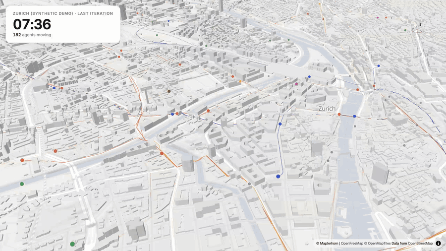

# matsim-agent-viz

A minimal 3D animation of the last iteration of a MATSim run. Each agent on a leg is a dot moving over a tilted map with terrain and 3D buildings. Dots are black by default, or coloured by mode.



*The synthetic test run from `examples/make_fake_run.py --osm`, not real data.*

With `--world` it builds a second kind of page instead: a 3D world you can explore, with cars, buses, trams, trains, bikes and walkers on streets lined with buildings and trees. See [The 3D world](#the-3d-world---world).

One Python script reads the run's final outputs and writes a single HTML page. The map, terrain and building tiles come from OpenFreeMap and Mapterhorn (no API key), so the page needs internet. The simulation data stays inside the file.

## Usage

Needs [uv](https://docs.astral.sh/uv/). It installs the dependencies, `pyproj` and `scipy`.

```sh
uv run matsim_agent_viz.py
```

This opens a launcher in your browser. Click **Choose…** to pick the run's output folder (macOS only; on Linux and Windows paste the path instead). The launcher shows which input files it found, and you can swap any of them. Pick the share of agents, then **Build and open**. When the page is ready it opens in the same tab. **Open last page** shows a page you built before, with no rebuild. The launcher remembers your last folder, file swaps, sample, title and coordinate system in `~/.config/matsim-agent-viz/launcher.json` (paths and settings only, no run data).

From the command line:

```sh
# build the page and open it
uv run matsim_agent_viz.py path/to/simulation_output

# open the existing page again, no rebuild
uv run matsim_agent_viz.py path/to/simulation_output --view
```

The page is written to `agents_3d.html` in the run folder (change this with `--out`). Everything is served on `127.0.0.1` only (port 8765 if it is free). Opening the HTML file directly fails in some viewers (Quick Look, editor previews) because they block WebGL. Stop the server with Ctrl-C or the launcher's **Quit**.

| Option | Default | Meaning |
|---|---|---|
| `run_dir` | none: opens the launcher | MATSim output folder |
| `--world` | | build the 3D world you can explore instead of the map |
| `--out` | `<run-dir>/agents_3d.html` (`agents_world.html` with `--world`) | HTML file to write |
| `--sample` | `0.1` | share of agents to show (stable hash of the person id) |
| `--title` | from the folder name | scenario name on the page |
| `--crs` | from `output_config.xml`, else the network | e.g. `EPSG:2056`, if the run doesn't set one (an LV95/LV03 guess is the fallback) |
| `--events`, `--network`, `--schedule`, `--config`, `--sharing` | found in the run folder | use a file from somewhere else |
| `--no-rail` | | trains and trams use the run's own links, no track download |
| `--no-walk` | | walkers move in straight lines, no footpath download |
| `--no-passenger` | | car passengers move in straight lines |
| `--view` | | open the existing page, no rebuild |
| `--no-open` | | only write the page |

A full Zurich 10% run (49 M events) takes about 2.5 minutes. With `--sample 0.1` the page is about 34 MB.

## What it reads

Plain or `.gz`, with or without a run-id prefix (`myrun.output_events.xml.gz`):

- `output_events.xml.gz` (required): movements of the final iteration
- `output_network.xml.gz` (required): link coordinates, and the coordinate system if the config doesn't set one
- `output_transitSchedule.xml.gz` (optional): stop coordinates, and which routes are trains or trams. Without it, PT riders follow the network links only.
- `output_config.xml` (optional): coordinate system (`global.coordinateSystem`) and last iteration number.
- sharing service file (optional): stations and bikes of a station-based bike-sharing service (shared_mobility contrib), e.g. `publibike_service.xml`. The script follows `serviceInputFile` in the config's `sharing` module and looks for the file in the run folder, next to the config and in the folder above. Otherwise pass it with `--sharing`. With several station-based services, the first one found is shown; pass `--sharing` to pick another.

It never reads the population, facilities or households files.

**Coordinate system.** The script takes it from `--crs`, else from `output_config.xml` (`global.coordinateSystem`), else from the network file's `coordinateReferenceSystem` attribute. EPSG codes work, and so do MATSim's own names such as `GK4`, `DHDN_GK4`, `CH1903_LV03_Plus` and `WGS84_UTM33N`. If none of these sets one, it can only guess the Swiss grids (LV95, LV03). For any other region, pass `--crs`, e.g. `--crs EPSG:25832`.

**Events format.** Only the standard XML events file (plain or `.gz`) is supported.

- **Car and PT**: dots follow the vehicle's link entries and stop events. This includes the SBB deterministic transit engine.
- **Trains and trams**: their network links are often straight lines from stop to stop (pt2matsim builds rail that way). So between two stops, dots follow the real railway tracks from OpenStreetMap instead. The script finds the shortest path along the tracks that never turns back at a switch, with trains kept on rail tracks and trams on tram tracks. Routes count as trains when their `transportMode` contains rail, train, subway, metro or S-Bahn, and as trams when it contains tram. The vehicle's route comes from the `TransitDriverStarts` events. If no suitable track is within 300 m of both stops, the dot goes straight, as before.
  - The tracks are downloaded from the Overpass API by 1° tile around the stops that riders used. A first build for all of Switzerland takes a few minutes. After that, the tiles come from `~/.cache/matsim-agent-viz/rail` (delete the folder to refresh them). Only the tile bounds go out, no run data.
  - `--no-rail` turns this off and skips the download.
- **Other network modes** (DRT, network-routed sharing, freight, …): any agent that enters a vehicle follows that vehicle's link events the same way. Not tested beyond car and PT.
- **Walks** (any mode with "walk" in its name, e.g. walk, access walks): MATSim teleports them, so it only knows where and when a walk starts and ends. Walkers follow the shortest path on OpenStreetMap footways, pedestrian zones, steps, paths and streets, and keep MATSim's start and end times.
  - The ways are downloaded from the Overpass API in tiles of 0.05° (about 5 × 4 km), only where sampled agents walk. The 40 tiles with the most walks get paths, and walks elsewhere stay straight. So do walks under 30 m or over 5 km, and walks whose start or end is more than 250 m from a path. Tiles are cached in `~/.cache/matsim-agent-viz/walk`. A tile can take a minute or more to download when Overpass is busy, so the first build of a large run can take a while. Only the tile bounds go out, no run data.
  - Each walk adds its own path to the page, about 300 bytes per walk.
  - `--no-walk` turns this off and skips the download.
- **Car passengers** (modes with "passenger" in the name, or `ride`): MATSim teleports them too. They follow the fastest path on the run's own car links at free-flow speed, keeping MATSim's start and end times, and get trip lines like cars. They get on and off at the nearest node of a road with a speed limit of 60 km/h or less (within 1 km), so never on a motorway. No download. `--no-passenger` turns this off.
- **Other teleported modes** (bike, …): dots move in a straight line at constant speed, because MATSim doesn't simulate the path.

Any mode name works. Common ones (car, pt, bike, walk, and a few from the Swiss eqasim scenarios such as `publibike` and `outside`) have fixed colours. Other modes get colours from a fallback palette, and their names are tidied up for the legend (`e_scooter` → "E scooter"). To give a mode its own colour, add it to `MODE_STYLE` in `page.html`.

## In the page

- **Panel**: play/pause, a timeline (24 h, longer if the run goes past midnight), speed (1/4/15/30 simulated min per second), the dot style (Black / By mode) and trip lines (Lines / Off). Click a mode to hide it.
- **Trip lines**: each leg in progress that is routed through the network (car, car passenger, PT and other network modes) shows its whole path from start to end as a faint line, with the part already travelled drawn stronger. Walks and other teleported legs (bike, …) get no line.
- **Stations** (only with a sharing service file): each station is a small isometric docking station at the middle of its link: a pad with five docks and a terminal with a sign. The docks fill with the bikes that are there at that moment (up to five), and the sign turns grey when the station is empty. Stations get smaller as you zoom out, so they don't crowd the map. A red ring on the ground marks a failed pickup or dropoff. Station counts use the pickup and dropoff events of all agents, not just the sample. Hover a station to see its id and bike count. The panel shows the bikes docked and the number of empty stations. Free-floating services have no stations and get no layer.
- **Keys**:
  - `Space` play/pause
  - `←` `→` ±5 min
  - `1`–`4` speed
  - `H` presentation mode (`Esc` also leaves it)
  - `L` street names
  - `T` trip lines
  - `S` stations
  - `?` help
- **Camera**: drag to pan; right-drag or Ctrl-drag to tilt and rotate.

## The 3D world (`--world`)


*The synthetic test run from `examples/make_fake_run.py --osm`, not real data.*

```sh
uv run matsim_agent_viz.py path/to/simulation_output --world
```

In the launcher, turn on the **3D world (Experimental)** toggle. The same run data goes into the page, plus which transit vehicle each sampled rider was on. The page is written to `agents_world.html` and does not replace the map page.

- **World**: built in your browser from OpenStreetMap vector tiles (OpenFreeMap) and terrain (Mapterhorn), so it works for any region with no extra download step. The style is flat-shaded low poly: faceted terrain and water, buildings with windows and pitched or flat roofs, roads with kerbs and lane markings, rails with sleepers, bridges with railings, footpaths, and trees in forests, parks and gardens. Further out there are buildings only, and to the horizon there is terrain painted with land cover. Tiles load as you move and the browser caches them. Only tile addresses go out, no run data.
- **Agents**: each mode gets a vehicle. Cars, car passengers and anything else on the road are cars, and trucks are trucks. Bikes and scooters are cyclists, and walks are walkers. A transit vehicle is drawn once for all its sampled riders: a bus, a 3-car tram, a 4-car train or a boat, depending on the route's `transportMode`. Riders stand at the stop until their vehicle comes. Cars keep to the right of the road. Colours are everyday colours, or **By mode**. Coloured dots mark agents too far away to see.
- **Sun**: follows the simulation clock, from sunrise at 6:00 to sunset at 20:00, with a dusk sky and a night sky. **Midday** keeps it at noon.
- **Camera**:
  - like the map page: drag to move, right-drag (or Ctrl/Alt/Shift-drag) to turn and tilt, scroll to zoom towards the cursor
  - **click** a vehicle or walker to ride along: chase camera, or `V` for the view on board. `R` rides along with someone near the centre of the view. A transit ride stays on the vehicle while sampled riders are aboard.
  - `Esc` stops riding, `H` hides the panels, `M` turns the dots off, `N` switches the sun between the clock and midday
- **Speed**: 1×, 10× (default), 1, 5 or 15 simulated minutes per second.
- **Limits**: bridges get a flat deck at the height of their highest bank, with short ramps, and vehicles drive on it; real bridge heights (high viaducts) are not in the map data. Each map tile sets its own deck height, so a bridge that crosses a tile edge can have a step there. Tunnels are not drawn: trains and cars in a tunnel run on the ground above it. Up close, land cover (grass, gardens, banks) is a painted texture and looks a little soft next to the crisp roads, paths and water. Bike-sharing stations are shown on the map page only. It needs a recent browser with WebGL 2 and module workers (Chrome, Edge, Safari 17+, Firefox).

## Test data

`examples/make_fake_run.py` writes a small synthetic run: a street grid around Zurich HB, a bus line, ten PubliBike stations with few bikes (so some pickups fail) and 3000 agents across nine modes. Use it to try the tool without real data:

```sh
uv run examples/make_fake_run.py /tmp/fake_run
uv run matsim_agent_viz.py /tmp/fake_run --sample 1
```

With `--osm`, the roads are central Zurich's real streets from OpenStreetMap instead of the grid, so cars and buses drive on real roads. The streets are downloaded once and cached in `~/.cache/matsim-agent-viz/demo_roads.json`. The GIF above was made this way, with `--sample 0.25`, at speed 1 and in presentation mode (`H`).

## Files

- `matsim_agent_viz.py`: reads the run and writes the page
- `launcher.html`: the launcher page (folder and file picker, build progress)
- `page.html`: the page template. `__DATA__`, `__TITLE__`, `__EYEBROW__` and `__NOTE__` are filled in by the script.
- `world.html`: the 3D world template (three.js, no build step), filled in the same way. A worker inside it builds each map tile.

## License

MIT, see [LICENSE](LICENSE).
