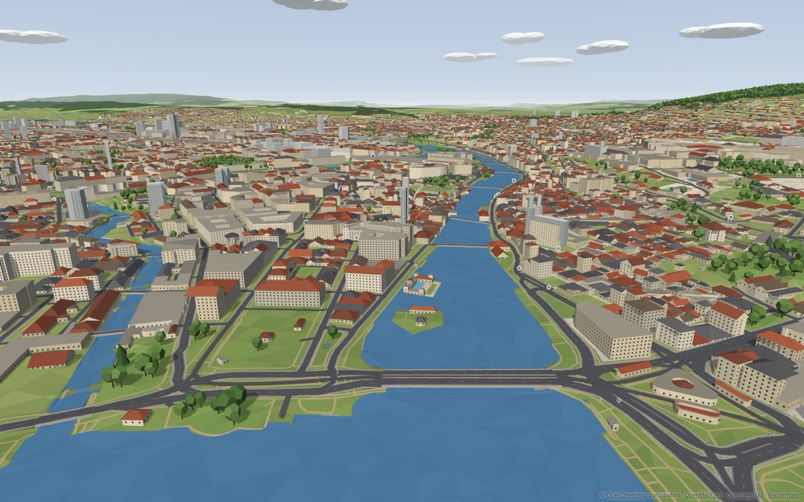
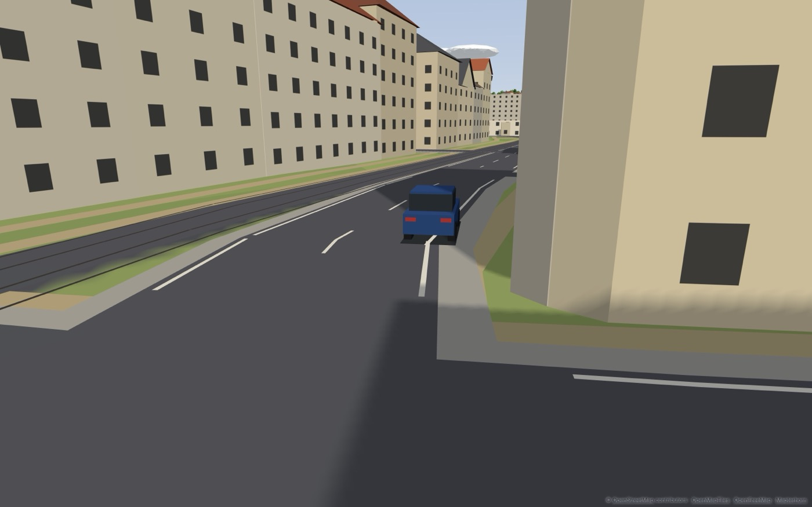

#  matsim-agent-viz

A minimal 3D animation of the last iteration of a MATSim run. Each agent on a leg is a dot moving over a tilted map with terrain and 3D buildings. Dots are black by default, or coloured by mode.


*The synthetic test run from `examples/make_fake_run.py --osm`, not real data.*

It can also build a second kind of page: a 3D world you can explore, with cars, buses, trams, trains, bikes and walkers on streets lined with buildings and trees. See [The 3D world](#the-3d-world).

**Open it at https://dremoment.github.io/matsim-agent-viz/**, choose the run's folder, and press **Build and open**. Nothing to install.

## Your run stays on your computer

The website reads the run in your browser tab. The files are never uploaded: the site is a set of static files on GitHub Pages, with no server that could receive them.

- The build runs in the tab, in JavaScript (`js/engine.js`). It reads only the events, network, transit schedule, config and bike-sharing station files. It never reads the population, facilities or households files.
- What leaves your computer: map tiles (OpenFreeMap, Mapterhorn), fonts and the map and 3D libraries. For trains and walkers, OpenStreetMap tracks and footpaths come by tile from the site itself ([ready-made tiles](#ready-made-tiles)) or else from the Overpass API, and only the tile bounds go out. A coordinate-system code the tool doesn't know is looked up on epsg.io; only the code goes out.
- Each page has a Content-Security-Policy that lists these hosts and blocks all others. So even a bug can't send your data anywhere else. You can check it in your browser's developer tools (Network tab), or read the policy at the top of `index.html`.

## Usage

1. Open the site in a recent Chrome, Edge, Firefox or Safari.
2. Drop the run's folder on the page, or click **Choose folder…**. The outputs may sit up to three folders down, as in `my_run/output/` (`ITERS` and hidden folders are skipped). If the folder holds several runs, the page asks you to choose one. The page lists the input files it found, and you can swap any of them with **Change…**. Firefox and Safari may ask whether to "upload" the files. They are only read in the tab.
3. Pick the share of agents and, if you like, the **3D world**, then **Build and open**. The page is named after the run folder (`--title` on the command line sets another name). The page opens in the same tab. **← Back** returns to the run, and **Save page** downloads the page as one HTML file you can share. To watch it again, open the site and use **Open a saved page…** (or drop the file on it). The site takes only the data and texts from the file and draws them with its own template, so a page from someone else can't run code there. A saved map page also opens straight from disk in Chrome, but the 3D world doesn't: browsers don't run its workers from a local file. Some viewers (Quick Look, editor previews) block WebGL.

The **Trains and walkers on OpenStreetMap paths** switch turns off the track and footpath downloads. Trains and trams then use the run's own links, and walkers move in straight lines.

Reading a full Zurich 10% run (49 M events) takes about 40 s in Chrome. With a 10% sample the page is about 34 MB. The browser remembers only the sample and the switches, not the folder.

### From the command line

For scripts, or to build without a browser, `tools/build.mjs` runs the same engine in Node 22 or newer:

```sh
node tools/build.mjs path/to/simulation_output              # writes agents_3d.html into the run folder
node tools/build.mjs path/to/simulation_output --world      # the 3D world, agents_world.html
```

| Option | Default | Meaning |
|---|---|---|
| `--world` | | build the 3D world you can explore instead of the map |
| `--out` | `<run-dir>/agents_3d.html` (`agents_world.html` with `--world`) | HTML file to write |
| `--sample` | `0.1` | share of agents to show (stable hash of the person id) |
| `--title` | from the folder name | scenario name on the page |
| `--crs` | from `output_config.xml`, else the network | e.g. `EPSG:2056`, if the run doesn't set one (an LV95/LV03 guess is the fallback) |
| `--events`, `--network`, `--schedule`, `--config`, `--sharing` | found in the run folder | use a file from somewhere else |
| `--no-rail` | | trains and trams use the run's own links, no track download |
| `--no-walk` | | walkers move in straight lines, no footpath download |
| `--no-passenger` | | car passengers move in straight lines |

It caches OpenStreetMap tiles in `~/.cache/matsim-agent-viz`.

### Running the site yourself

The site is static files, so any web server works, e.g. `python3 -m http.server 8000 --bind 127.0.0.1`, then open http://127.0.0.1:8000. It doesn't work from `file://`, because browsers don't run workers there.

## What it reads

Plain or `.gz`, with or without a run-id prefix (`myrun.output_events.xml.gz`):

- `output_events.xml.gz` (required): movements of the final iteration
- `output_network.xml.gz` (required): link coordinates, and the coordinate system if the config doesn't set one
- `output_transitSchedule.xml.gz` (optional): stop coordinates, and which routes are trains or trams. Without it, PT riders follow the network links only.
- `output_config.xml` (optional): coordinate system (`global.coordinateSystem`) and last iteration number.
- sharing service file (optional): stations and bikes of a station-based bike-sharing service (shared_mobility contrib), e.g. `publibike_service.xml`. The tool follows `serviceInputFile` in the config's `sharing` module and looks for the file in the run folder and its subfolders. Otherwise choose it with **Change…** (`--sharing` on the command line). With several station-based services, the first one found is shown; choose the file to pick another.

It never reads the population, facilities or households files.

**Coordinate system.** The tool takes it from `output_config.xml` (`global.coordinateSystem`), else from the network file's `coordinateReferenceSystem` attribute. EPSG codes work, and so do MATSim's own names such as `GK4`, `DHDN_GK4`, `CH1903_LV03_Plus` and `WGS84_UTM33N`. If none of these sets one, it can only guess the Swiss grids (LV95, LV03). For any other region, the build stops and the start page shows a **Coordinate system** field: enter one there, e.g. `EPSG:25832` (`--crs` on the command line, which also overrides the run's own). Common European grids are built in; other EPSG codes are looked up on epsg.io, and a proj string works too. Grids that need a shift file (German DHDN, British OSGB36) use a close approximation, accurate to a few metres.

**Events format.** Only the standard XML events file (plain or `.gz`) is supported.

- **Car and PT**: dots follow the vehicle's link entries and stop events. This includes the SBB deterministic transit engine.
- **Trains and trams**: their network links are often straight lines from stop to stop (pt2matsim builds rail that way). So between two stops, dots follow the real railway tracks from OpenStreetMap instead. The tool finds the shortest path along the tracks that never turns back at a switch, with trains kept on rail tracks and trams on tram tracks. Routes count as trains when their `transportMode` contains rail, train, subway, metro or S-Bahn, and as trams when it contains tram. The vehicle's route comes from the `TransitDriverStarts` events. If no suitable track is within 300 m of both stops, the dot goes straight, as before.
  - The tracks are downloaded from the Overpass API by 1° tile around the stops that riders used. The site publishes these tiles ready-made for all of Switzerland, so builds there need no download (see [Ready-made tiles](#ready-made-tiles)). Elsewhere, a first build for a whole country takes a few minutes. After that, the tiles come from the browser's cache (clear the site's data to refresh them; `~/.cache/matsim-agent-viz/rail` for the command line). Only the tile bounds go out, no run data.
  - The **Trains and walkers on OpenStreetMap paths** switch (`--no-rail`) turns this off and skips the download.
- **Other network modes** (DRT, network-routed sharing, freight, …): any agent that enters a vehicle follows that vehicle's link events the same way. Not tested beyond car and PT.
- **Walks** (any mode with "walk" in its name, e.g. walk, access walks): MATSim teleports them, so it only knows where and when a walk starts and ends. Walkers follow the shortest path on OpenStreetMap footways, pedestrian zones, steps, paths and streets, and keep MATSim's start and end times.
  - The ways are downloaded from the Overpass API in tiles of 0.05° (about 5 × 4 km), only where sampled agents walk. The 40 tiles with the most walks get paths, and walks elsewhere stay straight. So do walks under 30 m or over 5 km, and walks whose start or end is more than 250 m from a path. Tiles are cached like the rail tracks, and the site publishes them ready-made for the Zurich area. Elsewhere, a tile can take a minute or more to download when Overpass is busy, so the first build of a large run can take a while. Only the tile bounds go out, no run data.
  - Each walk adds its own path to the page, about 300 bytes per walk.
  - The same switch (`--no-walk`) turns this off and skips the download.
- **Car passengers** (modes with "passenger" in the name, or `ride`): MATSim teleports them too. They follow the fastest path on the run's own car links at free-flow speed, keeping MATSim's start and end times, and get trip lines like cars. They get on and off at the nearest node of a road with a speed limit of 60 km/h or less (within 1 km), so never on a motorway. No download. `--no-passenger` turns this off on the command line.
- **Other teleported modes** (bike, …): dots move in a straight line at constant speed, because MATSim doesn't simulate the path.

Any mode name works. Common ones (car, pt, bike, walk, and a few from the Swiss eqasim scenarios such as `publibike` and `outside`) have fixed colours. Other modes get colours from a fallback palette, and their names are tidied up for the legend (`e_scooter` → "E scooter"). To give a mode its own colour, add it to `MODE_STYLE` in `page.html`.

## In the page

- **Panel**: play/pause, a timeline (24 h, longer if the run goes past midnight), speed (1/4/15/30 simulated min per second), the dot style (Black / By mode) and trip lines (Lines / Off). Click a mode to hide it.
- **Trip lines**: each leg in progress that is routed through the network (car, car passenger, PT and other network modes) shows its whole path from start to end as a faint line, with the part already travelled drawn stronger. Walks and other teleported legs (bike, …) get no line.
- **Stations** (only with a sharing service file): each station is a small isometric docking station at the middle of its link: a pad with five docks and a terminal with a sign. The docks fill with the bikes that are there at that moment (up to five), and the sign turns grey when the station is empty. Stations get smaller as you zoom out, so they don't crowd the map. A red ring on the ground marks a failed pickup or dropoff. Station counts use the pickup and dropoff events of all agents, not just the sample. Hover a station to see its id and bike count. The panel shows the bikes docked and the number of empty stations. Free-floating services have no stations and get no layer.
- **Keys**:
  - `Space` play/pause
  - `←` `→` ±5 min
  - `1`–`4` speed
  - `H` presentation mode (`Esc` also leaves it)
  - `L` street names
  - `T` trip lines
  - `S` stations
  - `?` help
- **Camera**: drag to pan; right-drag or Ctrl-drag to tilt and rotate.

## The 3D world





*The synthetic test run from `examples/make_fake_run.py --osm`, not real data.*

Turn on the **3D world (Experimental)** switch (`--world` on the command line). The same run data goes into the page, plus which transit vehicle each sampled rider was on.

- **World**: built in your browser from OpenStreetMap vector tiles (OpenFreeMap) and terrain (Mapterhorn), so it works for any region with no extra download step. The style is flat-shaded low poly: faceted terrain and water, buildings with windows and pitched or flat roofs, roads with kerbs and lane markings, rails with sleepers, bridges with railings, footpaths, and trees in forests, parks and gardens. Further out there are buildings only, and to the horizon there is terrain painted with land cover. Tiles load as you move and the browser caches them. Only tile addresses go out, no run data.
- **Agents**: each mode gets a vehicle. Cars, car passengers and anything else on the road are cars, and trucks are trucks. Bikes and scooters are cyclists, and walks are walkers. A transit vehicle is drawn once for all its sampled riders: a bus, a 3-car tram, a 4-car train or a boat, depending on the route's `transportMode`. Riders stand at the stop until their vehicle comes. Cars keep to the right of the road. Colours are everyday colours, or **By mode**. Coloured dots mark agents too far away to see.
- **Sun**: follows the simulation clock, from sunrise at 6:00 to sunset at 20:00, with a dusk sky and a night sky. **Midday** keeps it at noon.
- **Camera**:
  - like the map page: drag to move, right-drag (or Ctrl/Alt/Shift-drag) to turn and tilt, scroll to zoom towards the cursor
  - **click** a vehicle or walker to ride along: chase camera, or `V` for the view on board. `R` rides along with someone near the centre of the view. A transit ride stays on the vehicle while sampled riders are aboard.
  - `Esc` stops riding, `H` hides the panels, `M` turns the dots off, `N` switches the sun between the clock and midday
- **Speed**: 1×, 10× (default), 1, 5 or 15 simulated minutes per second.
- **Limits**: bridges get a flat deck at the height of their highest bank, with short ramps, and vehicles drive on it; real bridge heights (high viaducts) are not in the map data. Each map tile sets its own deck height, so a bridge that crosses a tile edge can have a step there. Tunnels are not drawn: trains and cars in a tunnel run on the ground above it. Up close, land cover (grass, gardens, banks) is a painted texture and looks a little soft next to the crisp roads, paths and water. Bike-sharing stations are shown on the map page only. It needs a recent browser with WebGL 2 and module workers (Chrome, Edge, Safari 17+, Firefox).

## Test data

`examples/make_fake_run.py` writes a small synthetic run: a street grid around Zurich HB, a bus line, ten PubliBike stations with few bikes (so some pickups fail) and 3000 agents across nine modes. Use it to try the tool without real data:

```sh
uv run examples/make_fake_run.py /tmp/fake_run
node tools/build.mjs /tmp/fake_run --sample 1
```

Or drop `/tmp/fake_run` on the site.

With `--osm`, the roads are central Zurich's real streets from OpenStreetMap instead of the grid, so cars and buses drive on real roads. The streets are downloaded once and cached in `~/.cache/matsim-agent-viz/demo_roads.json`. The GIF above was made this way, with `--sample 0.25`, at speed 1 and in presentation mode (`H`).

## Files

- `index.html`: the website's start page (folder and file picker, build progress, the page viewer)
- `js/engine.js`: reads the run and builds the page data, in the browser and in Node
- `js/worker.js`: runs the engine in the background in the browser, and caches OpenStreetMap tiles
- `tools/osm-tiles.mjs`, `tools/osm-regions.json`: download the ready-made OpenStreetMap tiles the site publishes (see below)
- `page.html`: the map template. `__DATA__`, `__TITLE__`, `__EYEBROW__` and `__NOTE__` are filled in by the engine.
- `world.html`: the 3D world template (three.js, no build step), filled in the same way. A worker inside it builds each map tile.
- `tools/build.mjs`: the command line build
- `demo/zurich.json`: the start page's moving background, a fake run of Zurich (no real data). Remake it with `uv run examples/make_fake_run.py FAKE_RUN --osm`, then `node tools/build.mjs FAKE_RUN --sample 1 --json --out demo/zurich.json`.
- `demo/zurich.webp`, `demo/zurich@2x.webp`: a still of the background's first frame (07:30, camera not yet turned), shown until the live map is drawn. Take it again with `tools/capture-still.mjs` when the map style or the fake run changes.
- `logo.svg`: the logo and favicon
- `vendor/proj4.mjs`: [proj4js](https://github.com/proj4js/proj4js) 2.22.0 (MIT) as one ES module, for coordinate systems

No build step: the files are served as they are. The `Deploy site` workflow (`.github/workflows/pages.yml`) publishes the `main` branch to GitHub Pages, together with the ready-made tiles.

### Ready-made tiles

Downloading tracks and footpaths from Overpass is the slow part of a first build. So the site also publishes them, as gzipped JSON under `osm/rail/` and `osm/walk/`, for the areas in `tools/osm-regions.json`: rail tracks for all of Switzerland, footpaths for the Zurich area. The page looks for a tile in the browser's cache, then on the site, and only then asks Overpass. The site is the same origin as the page, so no new host is involved. It's public OpenStreetMap data, no run data.

The workflow downloads the tiles with `node tools/osm-tiles.mjs` (the engine's own queries), keeps them in the Actions cache, and refreshes them every Monday. A tile whose query changes in the engine is downloaded again on the next run. If that download fails, the tile is removed, so the page asks Overpass instead of using the old data. To cover another area, add a box to `tools/osm-regions.json`; a footpath tile is up to about 1.5 MB, a rail tile about 2 MB. `osm/` is not committed. Locally, the site works without it and falls back to Overpass.

## License

MIT, see [LICENSE](LICENSE).
